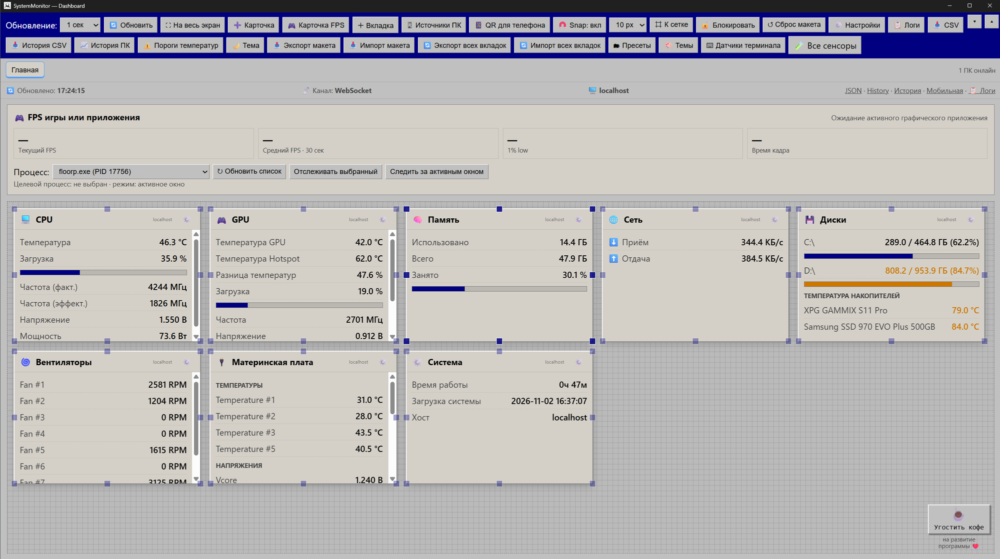
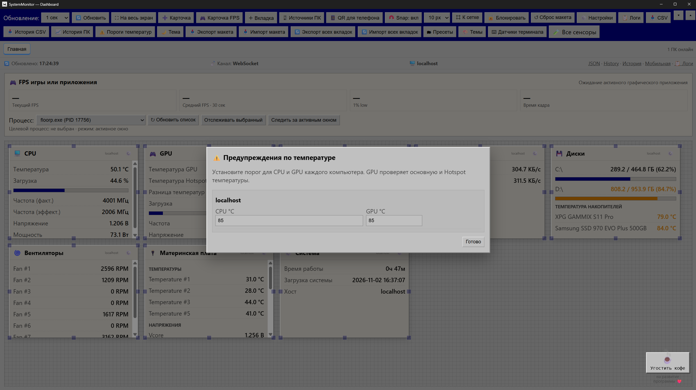
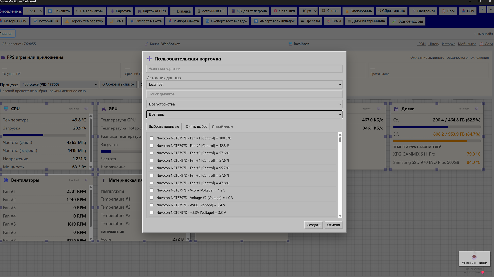
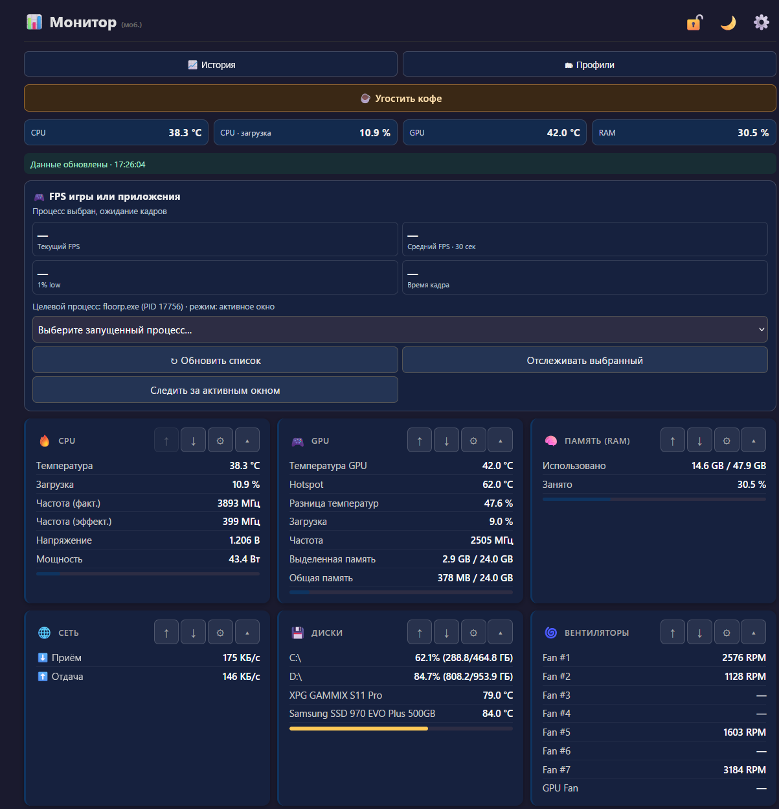
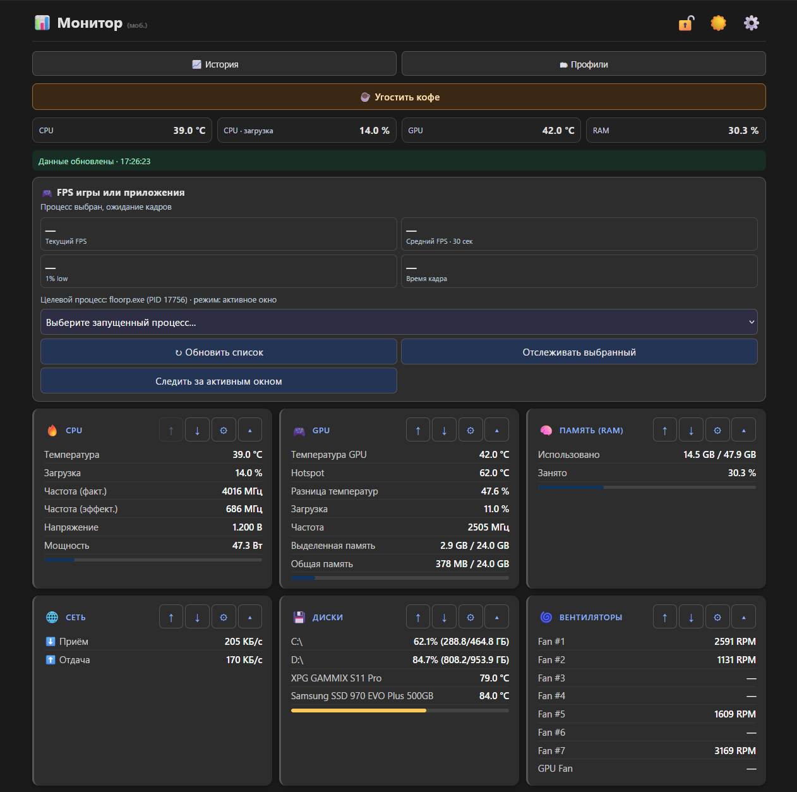
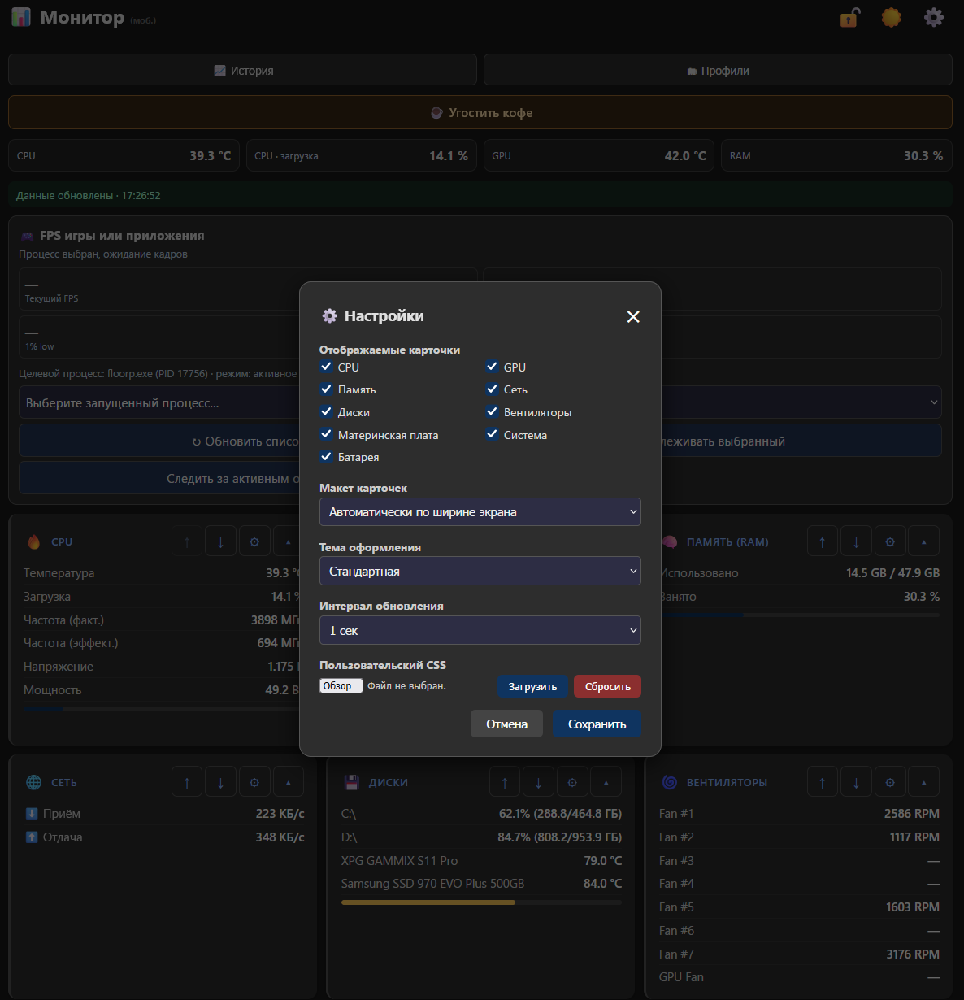

# SystemMonitor

[English](#english) | [Русский](#русский)

## English

SystemMonitor is a Windows desktop application for monitoring PC hardware and
viewing sensor data in desktop and mobile dashboards. It also provides optional
per-process FPS monitoring through PresentMon and Windows ETW.

You can also view this computer's sensor data from other computers or mobile
devices using a web browser, regardless of the device's operating system.

  
   
  <a href="https://www.donationalerts.com/r/monsterhairy"><strong>Buy the author a coffee</strong></a>
   
  Support the continued development of SystemMonitor ❤️

### Desktop Dashboard / Десктопный Dashboard

  
  
  

  Dashboard overview / Общий вид · Temperature alerts / Пороги температур · Custom card sensor selection / Выбор датчиков карточки

### Mobile Dashboard / Мобильный Dashboard

  
  
  

  Blue theme / Синяя тема · Dark theme / Тёмная тема · Settings / Настройки

### Requirements

- Windows 10/11, 64-bit
- Python and the project dependencies listed in `requirements.txt` to run from
  source
- The pinned runtime DLL dependencies and PresentMon executable used for the
  packaged app. The PawnIO driver is needed for some CPU/MSR/EC sensor
  readings. The PawnIO.Setup v2.1.0 installer is not included in this Git
  repository. To create a complete source build, download it from the
  [official release](https://github.com/namazso/PawnIO.Setup/releases/tag/2.1.0)
  and save it as `PawnIO_setup.exe` in the project root before building.
  Driver source and license notices are under `third_party/PawnIO/2.1.0`.
  See [BUILD.md](BUILD.md) and [THIRD_PARTY_NOTICES.md](THIRD_PARTY_NOTICES.md).

See [BUILD.md](BUILD.md) for setup, tests, and packaging instructions.

### Project status

SystemMonitor's original code is licensed under the MIT License; see
[LICENSE](LICENSE). Third-party components retain their own licenses and are
not relicensed by this license. Review
[THIRD_PARTY_NOTICES.md](THIRD_PARTY_NOTICES.md) before redistributing the
application or its bundled dependencies.

## Русский

SystemMonitor — настольное приложение для Windows, предназначенное для
мониторинга оборудования компьютера и просмотра данных датчиков на других компьютерах
и мобильной мобильных устройствах. Просматривать данные с компьютера можно везде где есть браузер. 
Неважно какое у вас устройство, с какой операционной системой,
главное что бы там был браузер, и вы сможете простматривать дитчики вашего компьютера.
Также приложение может отслеживать FPS отдельных процессов
с помощью PresentMon и Windows ETW.

  
   
  <a href="https://www.donationalerts.com/r/monsterhairy"><strong>Угостить автора кофе</strong></a>
   
  На развитие программы ❤️

### Требования

- Windows 10/11, 64-разрядная версия
- Python и зависимости проекта, перечисленные в `requirements.txt`, для запуска
  из исходного кода
- Закреплённые версии DLL-библиотек и исполняемый файл PresentMon, необходимые
  для готовой сборки. Драйвер PawnIO нужен для получения некоторых показаний
  датчиков CPU/MSR/EC. Установщик PawnIO.Setup 2.1.0 не включён в репозиторий
  Git. Для полной самостоятельной сборки скачайте его с
  [официальной страницы релиза](https://github.com/namazso/PawnIO.Setup/releases/tag/2.1.0)
  и сохраните в корне проекта под именем `PawnIO_setup.exe`. Исходный код
  драйвера и сведения о лицензиях находятся в `third_party/PawnIO/2.1.0`. См.
  [BUILD.md](BUILD.md) и
  [THIRD_PARTY_NOTICES.md](THIRD_PARTY_NOTICES.md).

Инструкции по настройке, тестированию и сборке приведены в [BUILD.md](BUILD.md).

### Статус проекта

Оригинальный код SystemMonitor распространяется по лицензии MIT; см.
[LICENSE](LICENSE). Эта лицензия не заменяет лицензии сторонних компонентов.
Перед распространением приложения и включённых зависимостей ознакомьтесь с
[THIRD_PARTY_NOTICES.md](THIRD_PARTY_NOTICES.md).
